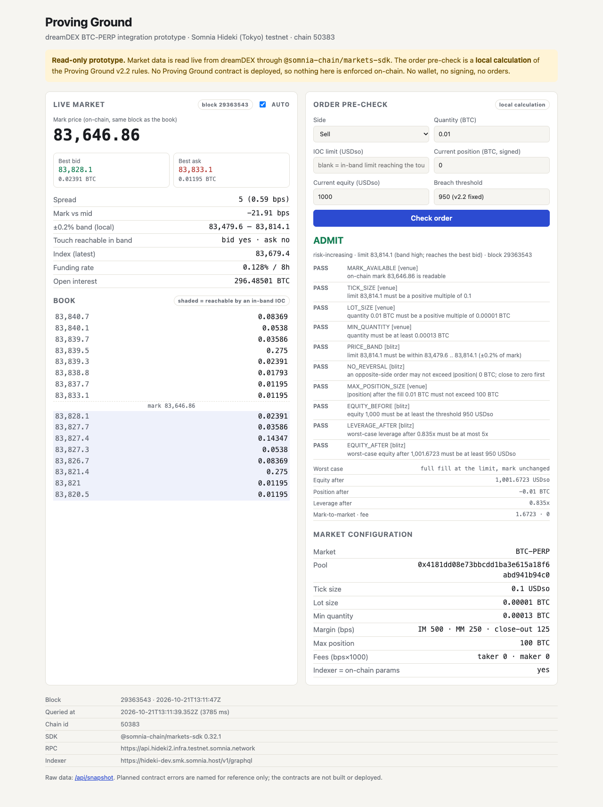

# Proving Ground: dreamDEX BTC-PERP integration prototype

A small, **read-only** integration with dreamDEX perps on the Somnia Hideki ("Tokyo") testnet, built with the official [`@somnia-chain/markets-sdk`](https://www.npmjs.com/package/@somnia-chain/markets-sdk).

It is the first working piece of **Proving Ground**, a planned testnet trading challenge for the dreamDEX Perps Builder Bounty. In that challenge a contract-owned account trades BTC-PERP under published rules and every run ends with verifiable on-chain evidence. This repository does not implement the challenge. It reads live BTC-PERP data and checks orders against the challenge's v2.2 rules **locally**.

> **Status: integration prototype, not the MVP.**
> - Reads live market data only. No private key, no wallet, no signing, no transactions.
> - No Proving Ground contract exists yet. The rule pre-check is a local calculation and is **not enforced on-chain**.
> - It does **not** meet the MVP track's live-order requirement. No order has been placed from this code.

## What it does

| Component | What it does | Data |
|---|---|---|
| `npm run snapshot` | Prints BTC-PERP market configuration, mark price, best bid/ask, spread, index, funding and open interest, with query time, chain ID, pool address and block number | Live: dreamDEX indexer and Hideki RPC |
| `npm run precheck` | Checks one IOC order against the Proving Ground v2.2 "Blitz" rules, using live market data and a hypothetical account state | Live market data plus a local calculation |
| `npm run serve` | Local page at `http://127.0.0.1:8787` with live BTC data (auto-refresh) and the same pre-check | Live market data plus a local calculation |
| `npm test` | 38 unit tests of the rule boundaries, unit handling and book derivations | Fixtures only, no network |
| `npm run test:live` | 8 read-only checks against the real network | Live |

The order book and the mark price are read **at the same block**, so the band check compares like with like. `getSpotOrderBook` reports the block it read; the mark and the on-chain book parameters are then read at that block through the SDK's own viem client.

## Network and versions

| | |
|---|---|
| Network | Somnia Hideki testnet ("Tokyo"), chain ID **50383** (v2, regenesised 2026-09-17) |
| RPC / WebSocket | `https://api.hideki2.infra.testnet.somnia.network` / `wss://api.hideki2.infra.testnet.somnia.network/ws` (from `@somnia-chain/markets-sdk/chains`) |
| Indexer | `https://hideki-dev.smk.somnia.host/v1/graphql` (the SDK docs list it for Hideki and call it development-grade) |
| BTC-PERP pool | `0x4181dd08e73bbcdd1ba3e615a18f6abd941b94c0` (discovered at runtime via `listPerpMarkets`; not hardcoded) |
| MarginBank | `0x478769e1177c0773c43a593dccc4ad15f15f1394` |
| SDK | `@somnia-chain/markets-sdk` **0.32.1** (exact pin) |
| Other dependencies | `viem` 2.57.7, `tsx` 4.23.15; dev: `typescript` 5.9.3, `@types/node` 22.20.5. `package-lock.json` is committed |
| Node.js | 20.12 or newer (tested on 22.23.1, macOS) |

All endpoints can be overridden in `.env` (see `.env.example`). Nothing in this repository needs a secret.

## Install and run

```bash
git clone https://github.com/a252937166/proving-ground-dreamdex.git
cd proving-ground-dreamdex
npm ci

npm run snapshot                       # live BTC-PERP snapshot, human-readable
npm run snapshot -- --json             # the same as exact JSON (integers as decimal strings)
npm run precheck -- --side buy --qty 0.01
npm run precheck -- --side sell --qty 0.005 --position 0.06 --equity 1000
npm run serve                          # then open http://127.0.0.1:8787
```

`--save PREFIX` writes `PREFIX.txt` and `PREFIX.json` from the same network read. Pre-check options:

| Option | Meaning | Default |
|---|---|---|
| `--side buy\|sell` | Order side | required |
| `--qty` | Quantity in BTC | required |
| `--price` | IOC limit in USDso | The least aggressive in-band limit that still reaches the touch, or the touch itself if no in-band limit can |
| `--position` | Hypothetical current position in BTC, signed | `0` (flat) |
| `--equity` | Hypothetical current equity in USDso | `1000` (a fresh Blitz allocation) |

## Verify

```bash
npm run typecheck    # tsc --noEmit
npm test             # 38 unit tests, fixtures only
npm run test:live    # 8 read-only tests against the live network
```

The live tests check that:
- the chain is 50383;
- the BTC-PERP pool has contract code;
- the indexer's tick, lot and minimum size equal the pool's on-chain `getOrderBookParameters()`;
- the mark is readable at the book's block, and the block time is close to local time;
- the book is non-empty, uncrossed, sorted and on the tick/lot grid;
- the mark is within 5% of the mid;
- the pre-check runs on live data.

## SDK and contract calls used

| Call | Purpose | Source |
|---|---|---|
| `client.getViemClient().getChainId()` | Refuse to run on any chain other than 50383 | RPC |
| `client.listPerpMarkets({ baseSymbol: "BTC", quoteSymbol: "USDso" })` | Discover the BTC-PERP pool and its configuration | Indexer |
| `client.getSpotOrderBook(pool, { depth })` | Bids, asks and the block they were read at (works on the perp pool's CLOB) | Chain |
| `PerpPool.tryGetMarkPrice()` at that block | Mark price used for the band and the leverage estimate | Chain |
| `PerpPool.getOrderBookParameters()` at that block | Cross-check the indexer's tick, lot and minimum size | Chain |
| `client.getPerpRiskParams(pool)` | Margin ratios, max position, max open interest, fees | Chain |
| `client.getPerpState(pool)` | Index price, funding rate, open interest (latest block) | Chain |

## Sample output (real)

Captured 2026-10-21 from the live network. Full files are in [`evidence/`](evidence/).

```text
dreamDEX BTC-PERP snapshot (read-only, live network)
  chain id            50383 (Somnia Hideki / Tokyo testnet)
  block               29364018  at 2026-10-21T13:12:35.000Z  (book and mark read at this block)
  SDK                 @somnia-chain/markets-sdk 0.32.1

Market configuration
  pool address        0x4181dd08e73bbcdd1ba3e615a18f6abd941b94c0
  tick size           0.1 USDso
  lot size            0.00001 BTC
  min quantity        0.00013 BTC
  book params         indexer config matches on-chain getOrderBookParameters(): yes
  margin (bps)        initial 500, maintenance 250, close-out 125
  max position        100 BTC

Prices at block 29364018
  mark                83,690.18  (tryGetMarkPrice ok: yes)
  best bid            83,876.4  (0.01176 BTC)
  best ask            83,881.6  (0.1434 BTC)
  mid / spread        83,879 / 5.2 (0.61 bps)
  mark vs mid         -22.51 bps

Proving Ground band: IOC limit within ±0.2% of mark (local calculation, not enforced on-chain)
  allowed limits      83,522.9 .. 83,857.5
  ask reachable       no  (a buy IOC with an in-band limit cannot reach the best ask now)
  bid reachable       yes  (a sell IOC with an in-band limit can reach the best bid now)
```

A pre-check of a prohibited reversal against live data ([`evidence/precheck-reversal-blocked.txt`](evidence/precheck-reversal-blocked.txt)):

```text
Proving Ground v2.2 Blitz order pre-check
LOCAL CALCULATION ONLY. No Proving Ground contract is deployed; nothing below is enforced on-chain.
  market data         live, block 29362561 (2026-10-21T13:10:09.000Z), chain 50383, pool 0x4181dd08e73bbcdd1ba3e615a18f6abd941b94c0
  order               SELL 0.02 BTC, IOC, limit 83,813.3 (band high; reaches the best bid)
  account (assumed)   position 0.01 BTC, equity 1,000 USDso; threshold 950
  classification      REVERSAL

  PASS   PRICE_BAND         [blitz] limit 83,813.3 must be within 83,478.8 .. 83,813.3 (±0.2% of mark)
  FAIL   NO_REVERSAL        [blitz] an opposite-side order may not exceed |position| 0.01 BTC; close to zero first  -> planned revert ReversalNotAllowed

VERDICT: REJECT (NO_REVERSAL)
```



### An observation from the live data

In every capture on 2026-10-21 between 13:00 and 13:13 UTC, the BTC-PERP book traded about 12–24 bps above the on-chain mark price; the funding rate was positive at about 0.13% per 8 h. With the band at ±0.2% of mark, a band-limited **buy** IOC often could not reach the best ask, while a sell could. dreamDEX's 2026-10-19 dev update lists work on "the mid/mark price gap", so this may change. The v2.2 rule numbers are provisional until IOC slippage is measured, and `npm run snapshot` measures the gap at any block.

## The rules being checked (v2.2 "Blitz", provisional numbers)

| Rule | Check | Planned contract revert |
|---|---|---|
| Market and type | BTC-PERP, IOC only | — |
| Venue format | Price on the 0.1 tick, quantity on the 0.00001 BTC lot, at least 0.00013 BTC, position at most 100 BTC | (venue) |
| Price band | IOC limit within ±0.2% of the on-chain mark | `PreTradeViolation(BAND)` |
| Classification | From flat or same side: **risk-increasing**. Opposite side with qty ≤ \|position\|: **reducing**. Opposite side with qty > \|position\|: **reversal** | — |
| Reversal | Not allowed; close to zero first | `ReversalNotAllowed` |
| Equity before (risk-increasing) | Equity ≥ 950 USDso (95% of the 1,000 allocation) | `PreTradeViolation(EQUITY_BELOW_THRESHOLD)` |
| Leverage and equity after (risk-increasing) | Worst case, a full fill at the limit with the mark unchanged: leverage ≤ 5x and equity ≥ 950 | `PostTradeViolation` |
| Reducing orders | Exempt from the leverage and equity checks. If the fill would leave equity below 950, the order still commits, and the account records the breach and starts its exit (`ADMIT_THEN_BREACH`) | — |

The planned contract checks the risk-increasing rules again **after** the fill, in the same transaction, using the account's actual position and equity. The local estimate here is the worst case for that check: an IOC cannot fill worse than its limit, and a larger fill only raises leverage. It assumes the fill does not move the mark.

Not modelled locally: the 60-minute expiry, tester authorization, one-operation-at-a-time locking, the pass condition, funding accrued between trades, and anything else that needs the account contract.

## What is tested, and how

| Layer | Status |
|---|---|
| Live network reads (indexer + RPC) | Done: `npm run snapshot`, `npm run test:live`, files in `evidence/` |
| Local rule pre-check | Done: 38 fixture-based unit tests (`npm test`), plus a live run in `npm run test:live` |
| Fork tests | **None yet** |
| Proving Ground contracts (House, ChallengeAccount, Referee) | **Not started** in this repository |
| Somnia Reactivity subscriptions | **Not started** |
| Order placement, deposits, withdrawals | **None.** This code never signs or sends a transaction |

## Limitations and unfinished work

- Read-only. It places no orders, so it is not evidence of live trading.
- The rule pre-check is local. Until the account contract exists and is tested, nothing enforces these rules.
- The account state (position, equity) is hypothetical and supplied by the user, not read from a real challenge account.
- The worst-case estimate assumes the mark does not move during the fill.
- Book depth is limited to the levels read (`BOOK_DEPTH`, default 20 per side).
- The Hideki indexer is development-grade per the SDK docs. If it stalls, market discovery fails; the chain reads would still work.
- `getPerpState` is read at the latest block, a moment after the book's block, so its mark can differ slightly from the block-pinned mark.
- `queriedAt` is the local machine clock. On the capture machine that clock ran about 7 s behind NTP, so block times in `evidence/` appear later than `queriedAt`.

**Next, per the project plan:**
1. Minimal contracts with local and fork tests (House, ChallengeAccount, Referee).
2. With separate authorization, a live lifecycle: deploy a challenge account, fund it, place one real BTC IOC, trigger a breach with a test threshold, exit and settle.
3. Reactivity-based breach handling.

## License

MIT
