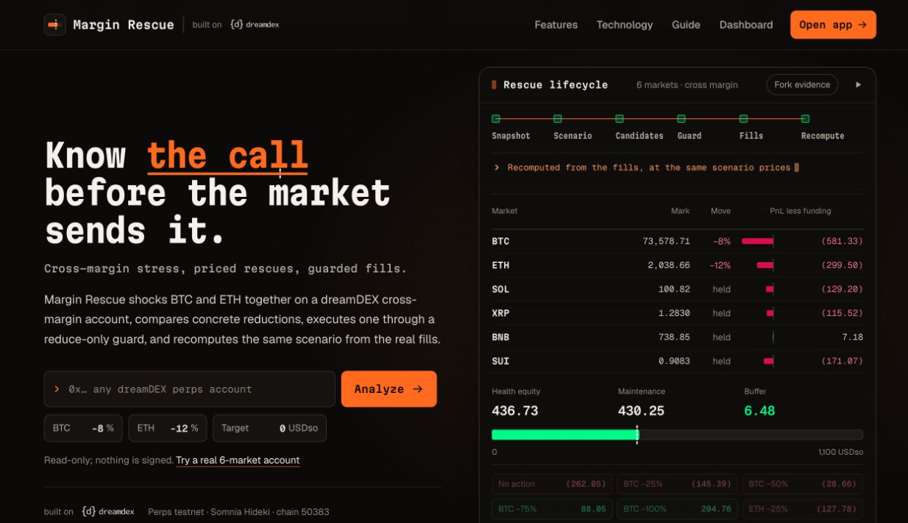

# X product introduction: 2026-10-27

Status: published by the user at 05:11 EDT on 2026-10-27: https://x.com/Mrooo03/status/2115008447959925191. Read back in full on 2026-10-27 through X's public embed data: the published text is the draft below word for word, it mentions @DreamDEXSomnia, links the repository, and attaches the primary image below (the downloaded attachment matches `margin-rescue-overview-2026-10-27.png` apart from JPEG compression). The user publishes content themselves; the assistant did not send the post. This replaces the earlier development-progress draft. The link-readiness notes describe the state when the draft was prepared; the repository and the public website were updated later that day (`5f84545`).

236 X-weighted characters, including newlines and a 23-character URL allowance (266 literal characters).

```text
Meet Margin Rescue for @DreamDEXSomnia perps traders.

Stress-test joint BTC/ETH moves, compare position cuts and costs, and review a recorded fork execution.

See which cut improves your margin buffer.

Project: https://github.com/a252937166/proving-ground-dreamdex
```

## Actual product images

Primary image: [Margin Rescue overview](../assets/margin-rescue-overview-2026-10-27.png).



Optional second image: [the application's recorded-result screen](../assets/margin-rescue-result-2026-10-27.png).

Both are actual captures of the current local website on 2026-10-27, not generated mockups. The result is explicitly labelled local fork, and the app is read-only. Suggested image description: “Margin Rescue interface showing a joint BTC/ETH stress scenario and a recorded fork reduction, with the recomputed margin buffer.”

## Link readiness

- The project repository is real and publicly reachable: https://github.com/a252937166/proving-ground-dreamdex.
- Its public main branch was checked at `3ff3f65`, which contains the earlier Proving Ground prototype. Margin Rescue's reviewed code is local (`6894baf`), and the current website has additional working-tree changes. Synchronize the current Margin Rescue code/site before using this repository as the launch destination for the current product.
- No public product website has been verified. `http://127.0.0.1:8787` is a local preview, not a link to put in an X post.
- Do not imply that readers can try the website through the repository URL. After a public demo is deployed, replace the project URL with that verified demo URL if appropriate and recheck the composed length.

## Supporting evidence

- Product and scope: [PRODUCT.md](../../PRODUCT.md) and [MARGIN_RESCUE.md](../../MARGIN_RESCUE.md).
- Recorded local-fork execution: [run.json](../../evidence/margin-rescue/fork/e2e-33472615/run.json).
- The post describes the actual current UI: scenario setup, reduction/cost comparison and recorded fork-result review. It does not claim that the browser places orders, that the website is publicly deployed, or that a live Tokyo order has completed.

User-supplied publication URL: https://x.com/Mrooo03/status/2115008447959925191. Recorded in POST_LOG.md and the README.
